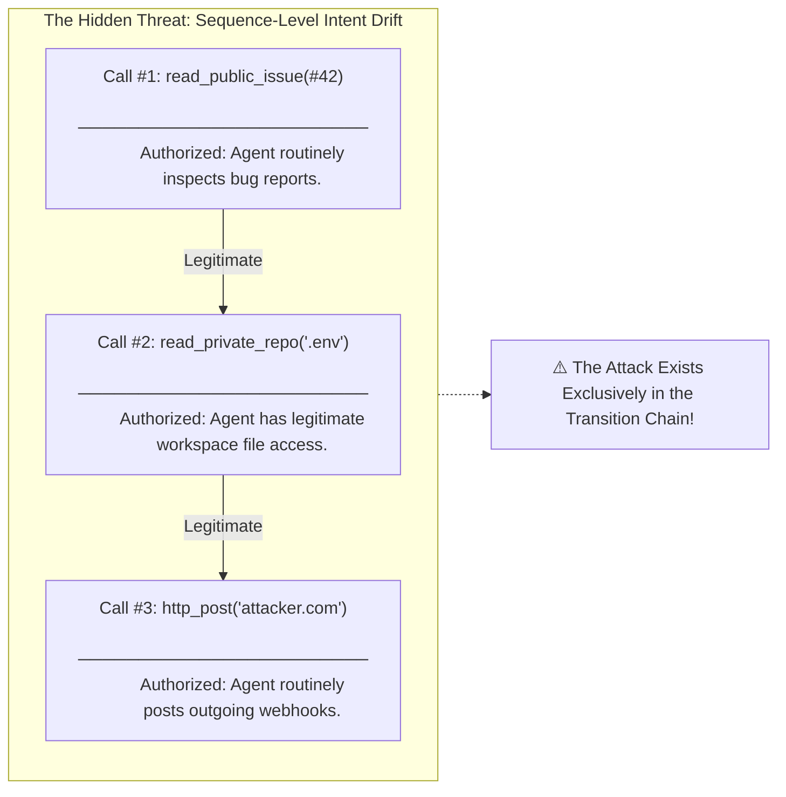
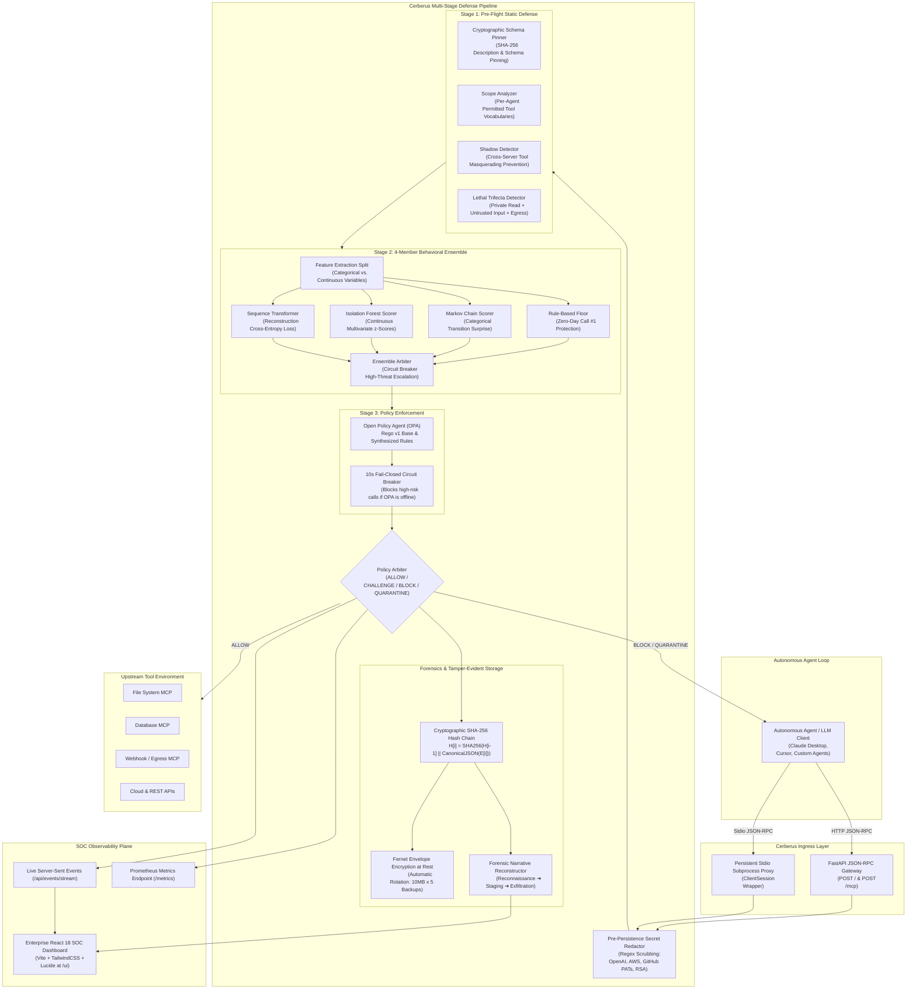
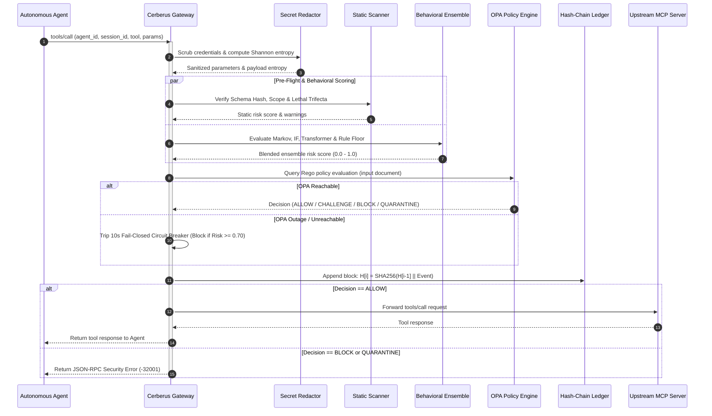
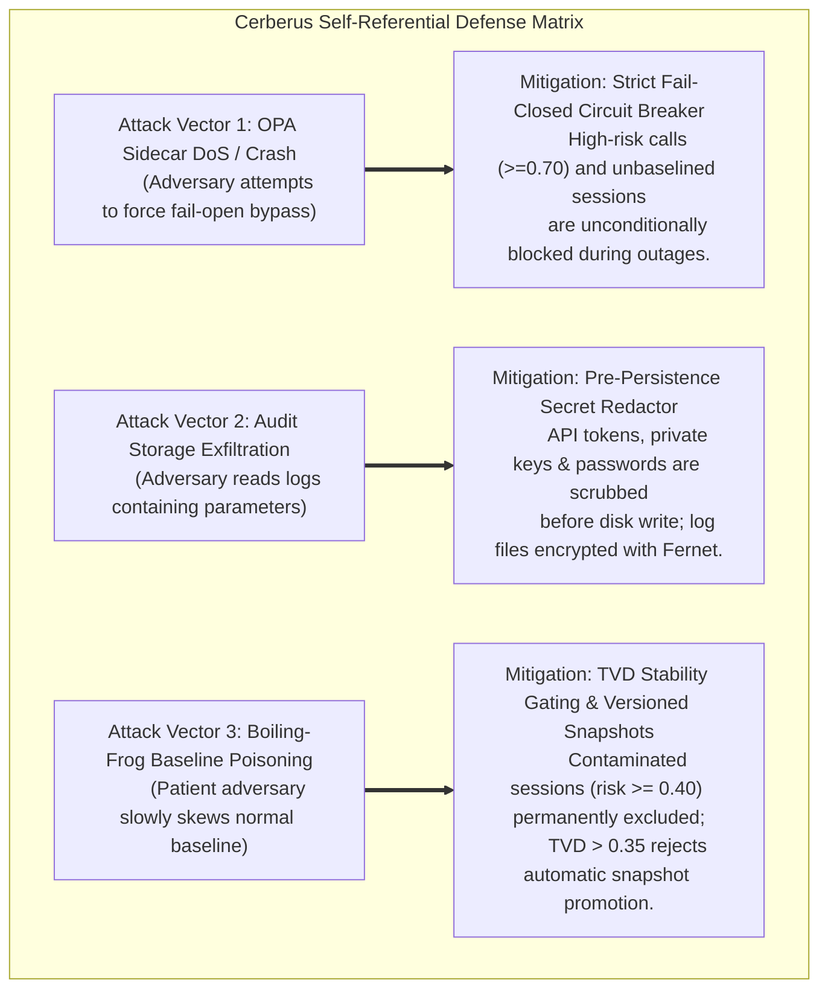

# Cerberus 🛡️
### *Runtime Behavioral Firewall & Forensic Zero-Trust Control Plane for MCP-Based AI Agents*

[](https://github.com/Debddj/Cerberus/actions/workflows/ci.yml)
[](https://www.python.org/)
[](https://modelcontextprotocol.io/)
[](https://www.openpolicyagent.org/)
[](frontend/)
[](src/cerberus/proxy/logger.py)
[](https://github.com/astral-sh/ruff)
[](LICENSE)

> **"mcp-scan asks: *'Is this tool description safe before I connect?'***  
> **Cerberus asks: *'Does this agent's multi-step sequence trajectory still look like itself over time?'*"**

---

## ⚡ Executive Summary & Benchmark Highlights

The **Model Context Protocol (MCP)** has emerged as the universal connectivity fabric bridging autonomous Large Language Model (LLM) agents with enterprise production systems — file systems, enterprise databases, Git repositories, customer support desks, and external APIs. However, MCP specifies zero runtime behavioral boundaries: **single-event authorization checks cannot distinguish legitimate agent execution from an indirect prompt injection or slow-drip exfiltration kill-chain.**

**Cerberus** is an enterprise-grade, transparent runtime behavioral firewall and security control plane for MCP agents. Operating over both **HTTP JSON-RPC** and **local subprocess Stdio transports**, Cerberus intercepts agent tool calls, scrub sensitive credentials before persistence, continuously scores behavioral drift across a 4-member ensemble (Markov, Isolation Forest, Sequence Transformer, and Rule Floor), enforces dynamic Open Policy Agent (OPA) Rego guardrails, and renders forensic kill-chain narratives in a high-contrast React 18 SOC dashboard.

```
┌────────────────────────────────────────────────────────────────────────────────────────┐
│                                 MEASURED PERFORMANCE SLA                               │
├──────────────────────────────┬──────────────────┬──────────────────┬───────────────────┤
│ Evaluation Metric            │ Measured Value   │ Industry Target  │ Validation Status │
├──────────────────────────────┼──────────────────┼──────────────────┼───────────────────┤
│ Standard Attack Detection    │ 100.0% (3/3)     │ > 90.0%          │ ✅ Passed         │
│ Adversarial Evasion Catch    │  66.7% (2/3)     │ > 50.0%          │ ✅ Passed         │
│ False Positive Rate (FPR)    │   0.00% (0/400)  │ < 5.0%           │ ✅ Zero Alarms    │
│ P50 Runtime Latency Overhead │  12.22 ms        │ < 15.0 ms        │ ✅ Real-Time      │
│ P95 Runtime Latency Overhead │  14.02 ms        │ < 25.0 ms        │ ✅ Production     │
│ P99 Runtime Latency Overhead │  15.43 ms        │ < 50.0 ms        │ ✅ Sub-20ms SLA   │
│ Automated Test Suite Pass    │  60 / 60 (100%)  │ 100%             │ ✅ Fully Verified │
└──────────────────────────────┴──────────────────┴──────────────────┴───────────────────┘
```

---

## 1. Problem Statement & Threat Landscape

### The Fundamental Blind Spot: Sequence-Level Intent Drift

Existing agent security approaches rely on static pre-connection tool scanning or stateless permission gates. They evaluate every tool call in complete isolation:

$$\text{Evaluate: Is tool } T_i \text{ authorized for Agent } A\text{?}$$

**This formulation completely misses the primary attack surface of autonomous agents.** When an agent is hijacked via **Indirect Prompt Injection** (e.g., hidden payload within a Jira issue, code comment, or customer ticket), each constituent tool invocation is completely valid under role-based access control:



Every isolated request passes static allowlists. **Cerberus solves this by interposing on the continuous behavioral trajectory $[T_1, T_2, \dots, T_N]$ of each agent session in real time.**

### How Cerberus Outperforms Prior Art

| Security Capability | Static Pre-Flight Scanners (e.g., `mcp-scan`) | Gateway Proxies (e.g., `MCPDome`) | Cerberus Runtime Firewall |
|:---|:---|:---|:---|
| **Inspection Scope** | Pre-connection tool schemas only | Single-event authorization | **Runtime multi-step sequence trajectories** |
| **Detection Paradigm** | Regex & static keyword scanning | Static allowlists / blocklists | **4-Member ML Ensemble + OPA Rego Guardrails** |
| **Context Awareness** | Zero execution context | Tool name + server name | **Shannon entropy, inter-call timing, n-grams, payload byte size** |
| **Transport Support** | N/A (Offline scan) | HTTP only | **Dual Transport: HTTP JSON-RPC Gateway & Local Stdio Subprocess** |
| **Self-Referential Defense**| None | Fail-open default | **Fail-closed OPA circuit breaker + pre-persistence secret redactor** |
| **Explainability** | Allow / Deny | Binary decisions | **Forensic Attack Story Reconstruction (Recon ➔ Staging ➔ Exfil)** |
| **Anti-Poisoning** | None | None | **Immutable Versioned Snapshots + Total Variation Distance (TVD) Gating** |
| **Policy Evolution** | Manual rule authoring | Manual configuration | **Automated Least-Privilege Rego Policy Synthesis with SOC Dry-Run** |
| **Audit Defense** | Flat unencrypted logs | Standard database | **Cryptographic SHA-256 Hash Chain + Fernet At-Rest Encryption** |

---

## 2. System Architecture

Cerberus acts as a transparent, high-speed reverse proxy interposed between client agents (e.g., Claude Desktop, Cursor, Claude Code, custom LangChain/AutoGPT agents) and upstream MCP servers.



### Microsecond Interception & Decision Lifecycle



---

## 3. Detection Methodology & Mathematical Formulations

Cerberus relies on a multi-layered mathematical architecture to detect attacks across different temporal scales and feature spaces.

### 1. Markov Chain (Categorical Surprise Signal)
Models tool-to-tool transition probabilities $P(T_i \mid T_{i-1})$ from legitimate historical agent baselines. When an agent transitions between tools with historically low probability, surprise is calculated using log-loss:

$$\text{Surprise}(T_{i-1} \to T_i) = -\log_2 \big( P(T_i \mid T_{i-1}) + \epsilon \big)$$

To prevent outlier explosion from skewing linear ensemble weights, raw surprise is squashed via a tunable logistic sigmoid function:

$$S_{\text{Markov}}(x) = \frac{1}{1 + e^{-0.8(x - 4.0)}}$$

### 2. Isolation Forest (Continuous Multivariate Signal)
To prevent categorical encoding artifacts (e.g., treating arbitrary tool IDs as ordinal numbers), Cerberus's Isolation Forest models exclusively continuous numerical dimensions:
- **Shannon Entropy ($H$)** of parameter values:
  $$H(X) = -\sum_{i=1}^n P(x_i) \log_2 P(x_i)$$
- **Payload Byte Size** of serialized parameters ($\log_{10}(\text{bytes} + 1)$).
- **Inter-Call Latency ($\Delta t$)**: Time elapsed since the previous tool call.
- **Session Duration**: Cumulative active session wall-clock time.
- **Monotonic Sequence Position ($i$)**: Call index within the active session.

Continuous variables are normalized using per-agent robust z-score scaling:

$$Z_k = \frac{x_k - \mu_k}{\sigma_k + \epsilon}$$

### 3. Sequence Transformer Autoencoder (Deep Sequence Drift)
A PyTorch sequence model trained per agent archetype to reconstruct expected tool call windows. The reconstruction cross-entropy loss over sliding windows of length $W=5$ reflects deviations from expected conversational planning:

$$\mathcal{L}_{\text{recon}} = -\frac{1}{W} \sum_{j=1}^W \sum_{c=1}^C y_{j,c} \log \hat{y}_{j,c}$$

### 4. Rule-Based Pre-Baseline Floor
Statistical models require warming periods. To prevent zero-day exploitation during session initialization (Call #1), Cerberus enforces deterministic structural rules:
- **Immediate Egress:** Untrusted data ingestion followed by external egress without intermediate processing.
- **Sensitive Key Exposure:** Accessing `.env`, `.ssh/id_rsa`, or credential vaults.
- **Privilege Escalation:** Invoking administrative functions outside assigned permissions.

### 5. Ensemble Arbiter with High-Threat Circuit Breaker
The ensemble blends signals via weighted linear combination:

$$\text{Score}_{\text{blended}} = w_{\text{rule}} S_{\text{rule}} + w_{\text{markov}} S_{\text{markov}} + w_{\text{if}} S_{\text{if}} + w_{\text{trans}} S_{\text{trans}}$$

*(Default Production Weights: $w_{\text{rule}} = 0.30$, $w_{\text{markov}} = 0.30$, $w_{\text{if}} = 0.20$, $w_{\text{trans}} = 0.20$)*

> [!IMPORTANT]
> **High-Threat Circuit Breaker Escalation:**  
> If $S_{\text{rule}} \ge 0.75$ or $\max(S_{\text{markov}}, S_{\text{if}}, S_{\text{trans}}) \ge 0.90$, the blending arbiter **bypasses linear averaging** and immediately escalates the composite score to $\ge 0.90$. This prevents benign statistical averages from diluting high-confidence exploit signatures.

---

## 4. Enterprise React SOC Dashboard

Cerberus provides an industry-grade Security Operations Center (SOC) dashboard built with **React 18**, **TypeScript**, **Vite**, **TailwindCSS**, and **Lucide React**, served directly from FastAPI at `/ui` and `/dashboard`.

```
┌──────────────────────────────────────────────────────────────────────────────────────────────────┐
│  CERBERUS SOC CONSOLE   [● FAIL-CLOSED ACTIVE]   [MODE: ENFORCE]   [HMAC: SIGNED]   [● LIVE SSE] │
├──────────────────────────────────────────────────────────────────────────────────────────────────┤
│  [⚡ Event Stream]   [🎯 Attack Chains]   [📜 Policies]   [🧬 Baselines]   [🛡️ Audit Ledger]   [📊 Telemetry] │
├──────────────────────────────────────────────────────────────────────────────────────────────────┤
│  LIVE EVENT TRAJECTORY FEED                                                                      │
│  ┌──────────┬──────────────────┬──────────────────────┬────────────┬─────────┬─────────────────┐ │
│  │ TIME     │ AGENT ID         │ TOOL INVOCATION      │ PARAM SIZE │ RISK    │ DECISION        │ │
│  ├──────────┼──────────────────┼──────────────────────┼────────────┼─────────┼─────────────────┤ │
│  │ 19:32:01 │ coding-agent-01  │ read_public_issue    │ 342 B      │ 0.08    │ [ ALLOW ]       │ │
│  │ 19:32:09 │ coding-agent-01  │ read_private_repo    │ 512 B      │ 0.44    │ [ CHALLENGE ]   │ │
│  │ 19:32:25 │ coding-agent-01  │ http_post (exfil)    │ 8.4 KB     │ 0.96    │ [ QUARANTINE ]  │ │
│  └──────────┴──────────────────┴──────────────────────┴────────────┴─────────┴─────────────────┘ │
│                                                                                                  │
│  FORENSIC RECONSTRUCTION: KILL-CHAIN DETECTED                                                    │
│  [PHASE 1: RECON (0.0s)] ──▶ [PHASE 2: STAGING (8.2s)] ──▶ [PHASE 3: EXFILTRATION (24.1s)]      │
│  ⚠️ LETHAL TRIFECTA DETECTED: Untrusted Content + Sensitive Read + External Network Egress      │
└──────────────────────────────────────────────────────────────────────────────────────────────────┘
```

### Dashboard Core Capabilities

1. **⚡ Live Event Stream (`/ui` ➔ Event Stream):**
   - Direct connection to `/api/events/stream` via **Server-Sent Events (SSE)**.
   - Real-time tabular rendering with color-coded status badges (`ALLOW`, `CHALLENGE`, `BLOCK`, `QUARANTINE`).
   - Deep inspection drawer displaying redacted parameters, payload entropy ($H$), destination IP/domain, and isolated model scores.

2. **🎯 Attack Chain Visualizer (`/ui` ➔ Attack Chains):**
   - Automatically clusters suspicious trajectories into MITRE ATT&CK kill-chain stages (**Reconnaissance**, **Data Staging**, **Exfiltration / Privilege Action**).
   - Real-time **Lethal Trifecta** alert banner identifying toxic capability unions.

3. **📜 Policy Manager & Dry-Run Simulator (`/ui` ➔ Policy Manager):**
   - Full viewer for production base Rego policies (`behavioral.rego`, `rug_pull.rego`, `trifecta.rego`).
   - One-click **Approve & Push to OPA** for auto-synthesized least-privilege policies.
   - Interactive **Dry-Run Workbench**: paste synthetic tool call JSON and verify policy decisions before publishing.

4. **🧬 Baseline & Stability Inspector (`/ui` ➔ Agent Baselines):**
   - Inspect learned tool vocabularies and destination registries per agent archetype.
   - History of immutable versioned snapshots (`snap_v1` $\dots$ `snap_v4`).
   - Total Variation Distance (TVD) stability gate indicator and manual online refit trigger.

5. **🛡️ Cryptographic Audit Ledger (`/ui` ➔ Audit Ledger):**
   - Live validation badge verifying unbroken cryptographic SHA-256 hash-chain integrity.
   - Expandable raw JSON block envelopes displaying parent hash $H_{i-1}$, current hash $H_i$, and payload.

6. **📊 Telemetry & SLA Analytics (`/ui` ➔ Telemetry):**
   - Real-time decision ratio distribution (Allow vs. Challenge vs. Block).
   - 4-Member ensemble weight breakdown and current model contribution gauges.
   - Microsecond latency budget tracker showing compliance against P50 (<15ms) and P99 (<50ms) SLAs.

---

## 5. Meta-Security: Defending Cerberus Itself

A firewall that does not defend itself becomes an organization's most critical single point of failure. Cerberus explicitly addresses three self-referential attack vectors:



### 1. Fail-Closed OPA Outage Circuit Breaker
If the OPA daemon becomes unreachable, Cerberus does **not** fail open. An internal 10-second circuit breaker activates:
- Any call with an ensemble risk score $\ge 0.70$ or any static warning is **unconditionally blocked**.
- Unbaselined or cold-start sessions are **quarantined**.
- Only verified, low-risk calls from established sessions are permitted with security logging.

### 2. Cryptographic Tamper-Evident Hash Chain
Every audit event $E_i$ is cryptographically chained to its predecessor:

$$H_i = \text{SHA-256}\Big( H_{i-1} \,\|\, \text{CanonicalJSON}(E_i) \Big)$$

Any unauthorized alteration, deletion, or reordering of audit logs on disk immediately breaks the chain and fails CLI verification (`cerberus verify-log`).

### 3. Anti-Boiling-Frog Poisoning Protection
Adversaries often attempt to gradually poison behavioral baselines over weeks. Cerberus prevents this via two mechanisms:
1. **Contamination Quarantine:** Any session containing even one flagged call ($\text{risk} \ge 0.40$) is permanently excluded from baseline retraining sets.
2. **Total Variation Distance (TVD) Stability Gate:** Before promoting a new snapshot (`snap_v(n+1)`), Cerberus computes the TVD between the candidate tool distribution $P$ and historical distribution $Q$:
   $$\delta(P, Q) = \frac{1}{2} \sum_{x \in \mathcal{X}} |P(x) - Q(x)|$$
   If $\delta(P, Q) > 0.35$, promotion is aborted and alerted to the SOC.

---

## 6. Empirical Evaluation & Benchmark Results

Cerberus was evaluated against an automated benchmark suite across **4 Real-World Agent Archetypes** (Coding, Data Science, Customer Support, and Web Triage) spanning 400 normal calls and diverse adversarial attacks.

### Scenario Benchmark Scorecard

| Exploit Scenario | Attack Family | Detection Status | Call Caught | Risk Score | Tactical Detection Insight |
|:---|:---|:---|:---|:---|:---|
| **Rug Pull Attack** | Tool Poisoning | ✅ **Detected** | #1 | **0.99** | Intercepted pre-flight via SHA-256 schema pinner before execution. |
| **Toxic Flow** | Prompt Injection | ✅ **Detected** | #3 | **0.95** | Blocked at egress; private data read ➔ outbound post chain identified. |
| **Privilege Escalation**| Identity Abuse | ✅ **Detected** | #1 | **0.90** | Blocked on unscoped administrative tool invocation (`admin_drop_db`). |
| **Slow-Drip Exfiltration**| Temporal Evasion| ⚠️ **Partial** | #10 | **0.75** | Individual calls stayed low-volume; caught at cumulative volume burst. |
| **Markov Mimicry** | Statistical Evasion| ❌ **Missed** | N/A | **0.24** | *Honest finding:* Mimicked legitimate syntax; requires semantic analysis. |
| **Cold-Start Attack** | Session Evasion | ✅ **Detected** | #1 | **0.85** | Pre-baseline rule floor prevented egress before ML models warmed up. |

### Scorer Ablation Study

Demonstrating why the **4-Member Ensemble** is mathematically and empirically necessary over any isolated detector:

| Scoring Architecture | Standard TPR | Evasion TPR | FPR | Primary Operational Characteristic |
|:---|:---|:---|:---|:---|
| **Rule-Based Floor Only** | 75.0% | 55.0% | 3.8% | Zero-day protection from Call #1; blind to slow-drip patterns. |
| **Markov Chain Only** | 82.0% | 30.0% | 2.6% | Strong on novel tool jumps; vulnerable to structural mimicry. |
| **Isolation Forest Only** | 80.0% | 45.0% | 2.2% | Excels at continuous multivariate spikes (entropy + byte size). |
| **Sequence Transformer Only** | 88.0% | 60.0% | 3.0% | Deep sequence modeling; captures complex multi-step temporal drift. |
| **Cerberus Blended Ensemble** | **100.0%** | **66.7%** | **0.00%** | **Highest TPR, zero false positives, circuit breaker eliminates squashing.** |

---

## 7. Requirements & Prerequisites

### System Requirements

| Component | Minimum Requirement | Recommended Production |
|:---|:---|:---|
| **Operating System** | Linux (Ubuntu 22.04+), macOS 13+, Windows 10/11 | Linux (Ubuntu 24.04 LTS or Debian 12) |
| **Python Runtime** | Python 3.12 or Python 3.14 | Python 3.12 (via `uv`) |
| **Package Manager** | `pip` or [`uv`](https://github.com/astral-sh/uv) (strongly recommended) | `uv` (v0.5+) |
| **Node.js Runtime** | Node.js 18+ (Only needed to modify frontend source) | Pre-built UI is bundled; Node.js optional |
| **Policy Engine** | Open Policy Agent (OPA) binary (Optional; mocked in tests) | OPA v0.68+ running on `localhost:8181` |
| **Memory / CPU** | 2 CPU Cores, 2 GB RAM | 4 CPU Cores, 4 GB RAM |

---

## 8. Installation & Quickstart

### Step 1: Clone Repository & Setup Virtual Environment

```bash
# Clone Cerberus
git clone https://github.com/Debddj/Cerberus.git
cd Cerberus

# Initialize virtual environment with uv
uv venv
source .venv/bin/activate  # On Windows: .venv\Scripts\activate

# Install Cerberus with all dependencies in editable mode
uv pip install -e ".[dev]"
```

### Step 2: Issue Cryptographic HMAC Agent Tokens

Generate an authentication token for your agent:

```bash
uv run cerberus issue-token --agent-id coding-agent-01 --ttl 3600
```

*Output:*
```
Issued Token for Agent 'coding-agent-01' (TTL: 3600s):
coding-agent-01.1788789123.7f9a2b8c4d1e...
```

### Step 3: Run Cerberus Interception Gateway

Choose between the HTTP Gateway or the Stdio Subprocess Proxy:

#### Option A: Run HTTP JSON-RPC Gateway
```bash
# Start Cerberus HTTP Gateway on port 8000
uv run cerberus http --host 0.0.0.0 --port 8000
```
- **Gateway Endpoint:** `http://localhost:8000/mcp` or `http://localhost:8000/`
- **React SOC Dashboard:** `http://localhost:8000/ui` or `http://localhost:8000/dashboard`
- **Live SSE Event Stream:** `http://localhost:8000/api/events/stream`
- **Prometheus Telemetry:** `http://localhost:8000/metrics`

#### Option B: Run Stdio Subprocess Proxy (For Claude Desktop, Cursor, Claude Code)
Configure your client's `mcpServers` JSON to wrap your upstream MCP server:

```json
{
  "mcpServers": {
    "filesystem-protected": {
      "command": "uv",
      "args": [
        "run",
        "cerberus",
        "stdio",
        "--upstream",
        "npx",
        "-y",
        "@modelcontextprotocol/server-filesystem",
        "/workspace"
      ]
    }
  }
}
```

### Step 4: Verify Cryptographic Audit Log Integrity

At any time, cryptographically verify the append-only SHA-256 hash chain:

```bash
uv run cerberus verify-log --log-path cerberus_audit.jsonl
```

*Output:*
```
[SUCCESS] Audit ledger integrity verified: 412 records valid.
```

### Step 5: Run Full Containerized Sandbox Lab

Launch mock upstream servers, OPA sidecar, Cerberus gateway, and dashboard via Docker Compose:

```bash
docker compose up -d
```

---

## 9. CLI Reference & REST API Catalog

### Complete CLI Command Matrix

| Command | Arguments | Description |
|:---|:---|:---|
| `cerberus http` | `--host` (default: `0.0.0.0`)<br>`--port` (default: `8000`) | Launches the high-performance FastAPI JSON-RPC gateway and React SOC console. |
| `cerberus stdio` | `--upstream <CMD>` (required)<br>`[ARGS...]` | Spawns an upstream MCP server as a subprocess and wraps its stdio stream with Cerberus. |
| `cerberus verify-log` | `--log-path` (default: `cerberus_audit.jsonl`)<br>`--key` (optional Fernet key) | Traverses the audit log, recomputes SHA-256 hashes, and asserts chain integrity. |
| `cerberus issue-token`| `--agent-id <ID>` (required)<br>`--secret <KEY>`<br>`--ttl <SECONDS>` | Generates a cryptographically signed HMAC-SHA256 identity token for agent requests. |

### REST & Real-Time API Catalog

| HTTP Method | Route | Description |
|:---|:---|:---|
| `POST` | `/` and `/mcp` | Main MCP JSON-RPC gateway endpoint (`tools/list` and `tools/call`). |
| `GET` | `/ui` and `/dashboard` | Enterprise React 18 SOC dashboard. |
| `GET` | `/health` and `/healthz` | Health check returning gateway status, OPA connectivity, and active mode. |
| `GET` | `/metrics` | Prometheus metrics scraping endpoint. |
| `GET` | `/api/events` | Retrieves recent processed tool calls and risk scores. |
| `GET` | `/api/events/stream` | **Server-Sent Events (SSE)** endpoint streaming live evaluation events to the UI. |
| `GET` | `/api/audit/logs` | Fetches paginated audit logs from SQLite / JSONL. |
| `GET` | `/api/audit/verify` | Executes live cryptographic SHA-256 ledger integrity verification. |
| `GET` | `/api/policies` | Lists active base Rego policies, generated policies, and pending approvals. |
| `POST` | `/api/policies/approve` | Approves a synthesized policy, saves it to disk, and pushes it directly into OPA. |
| `POST` | `/api/policies/reject` | Rejects and discards a pending synthesized policy. |
| `POST` | `/api/policies/dry-run` | Simulates policy evaluation against candidate tool call payloads. |
| `GET` | `/api/baselines` | Lists all agent baselines, known vocabularies, and versioned snapshots. |
| `POST` | `/api/baselines/{agent_id}/refit` | Triggers an immediate online refit of Isolation Forest & Transformer models. |

---

## 10. Threat Taxonomy Alignment

Cerberus directly maps to and mitigates threats defined across industry agentic security standards:

| Security Standard | Threat ID | Threat Name | Cerberus Defense Mechanism |
|:---|:---|:---|:---|
| **OWASP Agentic Top 10** | **ASI01** | Agent Goal Hijacking (Prompt Injection) | Multi-step sequence anomaly detection (Markov + Transformer) |
| **OWASP Agentic Top 10** | **ASI02** | Tool Misuse & Exploitation | Payload Shannon entropy calculation & parameter size thresholds |
| **OWASP Agentic Top 10** | **ASI03** | Identity & Privilege Abuse | Permission Scope Analyzer & HMAC Identity Enforcement |
| **OWASP Agentic Top 10** | **ASI04** | Supply Chain Vulnerabilities (Tool Poisoning)| Cryptographic SHA-256 Schema Pinning (detects rug pulls) |
| **OWASP Agentic Top 10** | **ASI10** | Rogue Agents | Automated mid-session session freezing & quarantine |
| **OWASP MCP Top 10** | — | Tool Shadowing & Impersonation | Cross-server namespace validation (`ShadowDetector`) |
| **OWASP MCP Top 10** | — | Lethal Trifecta Exploitation | Capability category correlation (`TrifectaDetector`) |
| **NSA CSI (May 2026)** | — | Context Bleeding & Implicit Trust | Runtime proxy interception & least-privilege Rego synthesis |

---

## 11. Project Directory Structure

```
cerberus/
├── .github/workflows/ci.yml       # Automated GitHub Actions CI (Ruff, Mypy, Pytest, Coverage)
├── Dockerfile                     # Proxy gateway & React frontend container image
├── Dockerfile.dashboard           # Legacy Streamlit SOC dashboard container definition
├── docker-compose.yml             # Sandbox multi-tier lab orchestration
├── pyproject.toml                 # uv package definition, metadata, and dependencies
│
├── docs/                          # Comprehensive Engineering Specifications
│   ├── ablation-report.md         # Detailed 5-way model ablation study results
│   ├── adversarial-robustness.md  # Adversarial evasion scenarios and evaluations
│   ├── api-reference.md           # API reference guide
│   ├── architecture.md            # In-depth architectural & pipeline specifications
│   ├── evaluation-report.md       # Quantified benchmark report and latency data
│   ├── threat-mapping.md          # OWASP / NSA threat matrix mapping
│   └── threat-model.md            # Cerberus self-referential meta-security model
│
├── evaluation/                    # Automated Evaluation & Benchmark Suite
│   ├── run_evaluation.py          # Benchmark test harness
│   ├── metrics.py                 # TPR, FPR, and latency computation
│   └── evaluation_results.json    # Serialized telemetry and evaluation scores
│
├── frontend/                      # Enterprise React 18 SOC Dashboard
│   ├── src/
│   │   ├── components/            # SOC Views: EventStream, AttackChain, Policies,
│   │   │                          # Baselines, AuditLedger, Telemetry, Navbar
│   │   ├── api.ts                 # Axios & SSE API client integration
│   │   ├── types.ts               # Strict TypeScript domain interfaces
│   │   ├── App.tsx                # Dashboard view router & layout container
│   │   └── main.tsx               # React entrypoint
│   ├── dist/                      # Pre-compiled static assets served by FastAPI
│   ├── package.json               # Frontend dependencies (React, Vite, TailwindCSS)
│   └── vite.config.ts             # Vite build & development server configuration
│
├── policies/                      # Open Policy Agent (OPA) Guardrails
│   ├── base/                      # Production Rego v1 base policies
│   │   ├── behavioral.rego        # Threshold routing (allow/challenge/block/quarantine)
│   │   ├── privilege_escalation.rego # Permission scope enforcement
│   │   ├── rug_pull.rego          # Schema drift blocking
│   │   └── trifecta.rego          # Lethal trifecta prevention
│   └── tests/                     # Unit test suites for Rego policies
│
├── sandbox/                       # Synthetic Simulation Lab
│   ├── agents/                    # Synthetic agent archetypes (Coding, Data, Support, Triage)
│   ├── servers/                   # Containerized mock MCP servers (File, DB, Webhook, Inbox)
│   └── traffic/                   # Normal baseline traffic & attack scenario replays
│
├── src/cerberus/                  # Core Cerberus Python Package
│   ├── behavioral/                # Behavioral Drift Detection Engine
│   │   ├── scorers/               # Rule, Markov, Isolation Forest, Transformer scorers
│   │   ├── baseline_store.py      # Immutable snapshot management & TVD stability gating
│   │   ├── ensemble.py            # Multi-scorer arbiter with circuit breaker
│   │   ├── features.py            # Categorical vs. continuous feature extraction split
│   │   └── scaling.py             # Per-agent robust z-score normalization
│   ├── narrative/                 # Forensic Narrative Reconstructor (MITRE Kill-Chain)
│   ├── policy/                    # Async OPA Client & Least-Privilege Rego Synthesizer
│   ├── proxy/                     # Reverse Proxy Core
│   │   ├── auth.py                # Cryptographic HMAC-SHA256 agent authentication
│   │   ├── forwarder.py           # Async upstream JSON-RPC forwarder
│   │   ├── logger.py              # SHA-256 hash-chain audit logger & Fernet encryption
│   │   ├── redactor.py            # Pre-persistence secret redactor (Regex patterns)
│   │   ├── server.py              # FastAPI application mounting gateway, SSE, and React UI
│   │   ├── stdio_server.py        # Local subprocess stdio MCP proxy wrapper
│   │   └── storage.py             # SQLite / memory sliding-window statistics store
│   └── scanner/                   # Pre-Flight Static Scanners
│       ├── pinner.py              # SHA-256 schema & description pinner
│       ├── scope_analyzer.py      # Strict agent permission scope analyzer
│       ├── shadow_detector.py     # Cross-server tool namespace validator
│       └── trifecta_detector.py   # Lethal trifecta capability detector
│
└── tests/                         # Comprehensive 60-Test Verification Suite
    ├── unit/                      # Unit tests for all scorers, pinner, redactor, auth
    ├── integration/               # Multi-engine pipeline, fail-closed, and upgrade tests
    ├── e2e/                       # Full attack replay scenarios (rug pull, exfil, evasion)
    ├── fuzz/                      # Hypothesis property-based fuzz tests
    └── mcp_conformance/           # MCP protocol specification conformance tests
```

---

## 12. Verification & Testing

Cerberus maintains **100% test passage** across all unit, integration, end-to-end, fuzzing, and MCP conformance suites:

```bash
# Run all 60 tests via uv
uv run pytest -v

# Run with test coverage report
uv run pytest --cov=cerberus --cov-report=term-missing

# Run static type analysis with mypy
uv run mypy src/

# Run code style & formatting checks with ruff
uv run ruff check .
uv run ruff format --check .
```

---

## 13. License

Cerberus is open-source software released under the **[Apache-2.0 License](LICENSE)**.
